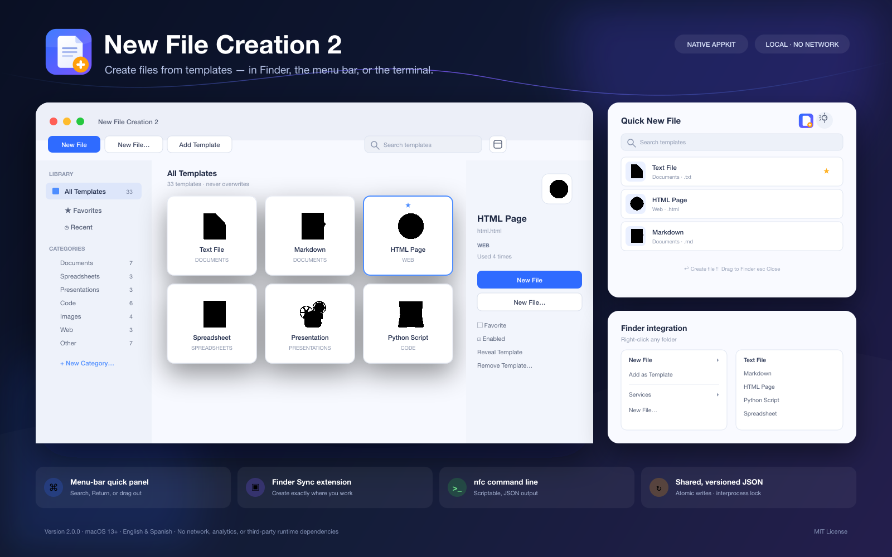

# New File Creation 2

Create files from templates in Finder, from the menu bar, from a template library, or with the `nfc` command-line tool.

New File Creation 2 is a native, local-first macOS utility written in Objective-C and AppKit. It never overwrites an existing file, never deletes a template without confirmation, and makes no network requests. Configuration and templates live in one shared folder so the app, the Finder extension, and the CLI always agree.



**Version:** 2.0.0  
**Minimum macOS:** 13.0 Ventura  
**License:** MIT

## Features

- **Menu bar app with no Dock icon.** The permanent menu bar icon is the entry point. The library, Settings, Welcome, and quick panel are all floating panels opened from the menu bar.
- **Template library** with a source-list sidebar, searchable card grid, inspector, favorites, recents, categories, and drag-to-Finder.
- **Menu bar quick panel** with visual, draggable template rows, keyboard-first search, arrow-key navigation, Return to create, Esc to close, and a gear that opens Settings.
- **Drag from the menu bar** into Finder or any file-promise-aware window to create a default-named file from the template.
- **Finder Sync extension** with a New File template menu and “Add as Template” for selected Finder items.
- **`nfc` command-line tool** for scripted creation, listing, adding, removing, favoriting, enabling, diagnostics, configuration export/import, and shell completion.
- **Shared, versioned JSON configuration** written with an interprocess lock and atomic replacement.
- **Never overwrites** files: names are made unique with `Untitled 2`, `Untitled 3`, and so on.
- **Custom categories and configurable sound** in Settings, with system sounds available by name.
- **Local only:** no accounts, network, analytics, telemetry, iCloud sync, or third-party runtime dependencies.
- **English and Spanish** app and Finder extension UI.

## Requirements

- macOS 13 or later.
- Xcode 27.2 or later with the macOS SDK.
- [XcodeGen](https://github.com/yonaskolb/XcodeGen) 2.46 or later (`brew install xcodegen`) to regenerate the project.
- No runtime dependencies. The app, Finder extension, and CLI are all Objective-C/AppKit/Foundation.

## Install locally

```bash
git clone <repository-url>
cd new-file-creation-2
./scripts/build.sh          # Release build, ad-hoc signed
./scripts/install.sh        # copies to /Applications, or ~/Applications if needed
./scripts/install-cli.sh    # links ~/.local/bin/nfc to the embedded helper
```

The app is ad-hoc signed and intended for local/direct distribution. It is not sandboxed; the Finder extension is sandboxed. No Apple Developer Team ID or App Group is required.

After installing, open the app once so macOS registers the Finder extension, then enable **New File Creation 2 Finder** in **System Settings › General › Login Items & Extensions › Finder Extensions**.

If `~/.local/bin` is not on your `PATH`, the CLI installer prints the line to add to your shell profile:

```bash
export PATH="$HOME/.local/bin:$PATH"
```

## First use

- **⌘N** creates a file from the selected template in the default folder.
- **⇧⌘N** opens a save panel so you can choose a name and location.
- **⌃⌥N** (Control-Option-N) opens the quick panel from anywhere. Change it in Settings › General.
- **Right-click in Finder** and choose a template under **New File**. Choose **Add as Template** to add selected files to the library.
- **Menu bar icon:** left-click for the visual quick panel; drag a template row into a Finder window to create a file there; right-click for Library, Settings, Welcome, and Quit.
- **`nfc create "Text File"`** creates a file in the current terminal directory.

The app launches silently into the menu bar with no Dock icon. The first run seeds the 33 included templates into the support folder. They can be disabled, renamed, favorited, moved to custom categories, or removed like any other template.

## Support folder

```
~/Library/Application Support/New File Creation 2/
├── config.json          # settings, templates, recents, revision
├── config.json.bak      # previous config written by NFConfigStore
├── config.lock          # flock file for writers
├── Backups/             # quarantined corrupt configs
├── Templates/           # copied template files
└── logs/                # local diagnostic log
```

Set `NFC_SUPPORT_DIR` to an absolute path to run the CLI or tests against an isolated support folder. This is intended for development and testing, not normal use.

## Command line

`nfc` is embedded at:

```
New File Creation 2.app/Contents/Helpers/nfc
```

It is a normal command-line tool and does not require the app to be running. The default file name comes from the app setting `defaultBaseName` (default `Untitled`), never from the template display name.

```bash
nfc list
nfc create "Text File"                  # ./Untitled.txt
nfc create script.py --name "hello"     # ./hello.py
nfc create "HTML Page" --dir ~/Documents --reveal
nfc add ~/Documents/notes.md --category Documents --favorite
nfc show "Text File" --json
nfc status --json
nfc doctor --json
nfc completion zsh
```

See [docs/CLI.md](docs/CLI.md) for the full reference, JSON envelope, exit codes, and recipes. The man page source is [docs/nfc.1](docs/nfc.1).

## Build and test

```bash
xcodegen generate
./scripts/build.sh          # Release
CONFIG=Debug ./scripts/build.sh
./scripts/test.sh           # XCTest suite: logic, AppKit UI, drag/drop (84 tests)
./scripts/test-cli.sh       # isolated end-to-end CLI checks
./scripts/verify.sh         # signing, bundle, resources, tests, CLI
./scripts/verify.sh --quick # skip the test suites
./scripts/make-icon.sh      # regenerate the icon from AppIcon.svg
```

The XCTest bundle instantiates AppKit windows and controllers directly to cover the floating library panel, quick panel, Settings, Welcome panel, menu bar menu, menus, and toasts. Drag/drop tests exercise quick-panel file promises and grid file URLs against custom drop windows, desktop-style folders, and optional real destinations:

```bash
NFC_TEST_REAL_DESKTOP=1 ./scripts/test.sh              # also write to a hidden folder on the real Desktop
NFC_TEST_EXTERNAL_VOLUME=/Volumes/MyDisk ./scripts/test.sh  # also write to a mounted external volume
```

External-volume coverage is skipped when no writable external volume is available. See [docs/TEST-MATRIX.md](docs/TEST-MATRIX.md) for suite details and the manual checks that still require OS-level gestures.

Build products:

```
build/New File Creation 2.app
build/New File Creation 2.app/Contents/PlugIns/New File Creation 2 Finder.appex
build/New File Creation 2.app/Contents/Helpers/nfc
```

## Project layout

```
NewFileCreation2App/        AppKit app, menus, library, quick panel, settings
NewFileCreation2Finder/     Finder Sync extension
NewFileCreation2Shared/     Models, config store, file creation, requests, menus
NewFileCreation2CLI/        nfc command-line tool
NewFileCreation2Tests/      XCTest unit suite
Templates/                  33 bundled templates copied into the library
docs/                       Architecture, UI, CLI, man page, test matrix
scripts/                    Build, test, install, uninstall, verify, icon
project.yml                 XcodeGen specification
```

## Documentation

- [docs/ARCHITECTURE.md](docs/ARCHITECTURE.md) — process model, shared core, config, locking, Finder sandbox.
- [docs/UI-DESIGN.md](docs/UI-DESIGN.md) — visual language, windows, keyboard and accessibility.
- [docs/CLI.md](docs/CLI.md) — full `nfc` reference and scripting recipes.
- [docs/TEST-MATRIX.md](docs/TEST-MATRIX.md) — automated and manual verification matrix.
- [docs/finder-extension-spike.md](docs/finder-extension-spike.md) — Finder Sync read-only config and fallback notes.

## Privacy

New File Creation 2 makes no network connections. It has no analytics, telemetry, crash reporting, accounts, or update checker. Everything stays in the support folder on your Mac. The Finder extension only reads the shared configuration and creates files in the folder you target.

## Uninstall

```bash
./scripts/uninstall.sh              # moves the app to Trash, keeps templates
./scripts/uninstall.sh --remove-data # also moves the support folder to Trash
```

The CLI installer’s symlink can be removed independently:

```bash
./scripts/install-cli.sh --uninstall
```

## Credits

New File Creation 2 is an independent Objective-C/AppKit rewrite inspired by the MIT-licensed **New File Creation** by Sergio Martinez-Losa. The included template set is preserved from the original project. SF Symbols and system frameworks are provided by Apple.

Copyright © 2024–2026 Sergio Martinez-Losa. MIT licensed; see [LICENSE](LICENSE).
